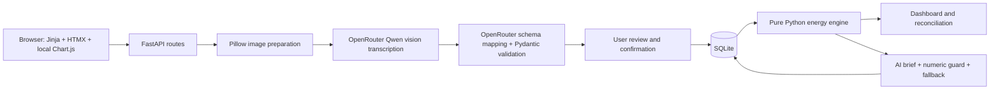
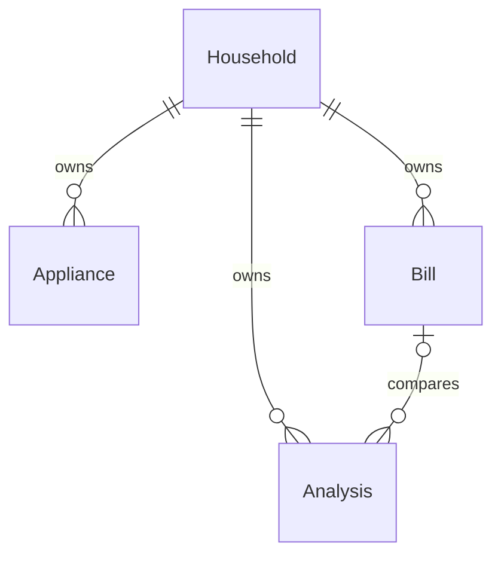

# WattLens

Turn appliance label photos and electricity bills into a reviewable household energy estimate. Confirm the AI readings, adjust usage assumptions, compare the inventory with billed units, and save a brief whose numbers are checked against deterministic calculations.

Built against the supplied `prd.pdf` and WattLens build prompt. **Authorized scope change:** AI now runs on OpenRouter using `qwen/qwen3-vl-8b-instruct` rather than local Ollama. The original local-only and 4B model constraints are superseded by this change. Uploaded images leave the machine in live mode; the interface discloses this. This model is Qwen, not Grok.

## Run locally

Python 3.12 is the tested version. No Node build or Ollama installation is required.

```sh
python3 -m venv .venv
.venv/bin/python -m pip install -r requirements.lock.txt
cp .env.example .env
# Edit .env and set OPENROUTER_API_KEY to your own OpenRouter key.
.venv/bin/python -m uvicorn app.main:app --host 127.0.0.1 --port 8000
```

Open http://127.0.0.1:8000. `.env` loads automatically; existing environment variables take precedence. Never commit keys. The API key stays on the server and is not rendered into the browser. SQLite records, uploaded images, logs, and environment files are ignored by Git.

`MODEL_NAME` defaults to the exact requested model. `AI_TIMEOUT` defaults to 90 seconds per API request. `DATABASE_URL`, `UPLOAD_DIR`, and `DEMO_MODE` are configurable; see `.env.example`. `/healthz` reports configuration only and makes no paid model call; it does not claim connectivity.

For an offline demonstration, use the **Explore demo household** button or set `DEMO_MODE=1`. Demo and live records are separated. Demo uploads replay saved synthetic examples regardless of the photo, as stated in the visible banner.

## P0 workflow

1. Upload one to twelve JPEG/PNG/WebP label images, each at most 10 MB.
2. Images are validated, EXIF-rotated, converted to RGB, stripped of metadata, resized to at most 1536 pixels on the longest edge, and saved with random names.
3. OpenRouter reads visible label information. A second request maps only that transcription to the appliance schema. Missing fields remain null; invalid JSON gets one retry; failures leave a manual review draft.
4. Review specifications and operating assumptions, then save. Manual entry, editing, and deletion are available.
5. The dashboard ranks estimated users and shows assumed ranges and inventory shares.
6. Upload a bill image, confirm its five extracted fields, and save it.
7. Compare estimates with billed units and generate three findings and three actions. Unsupported numbers are rejected; one regeneration is attempted, then a deterministic fallback is used.
8. Saved analyses contain an appliance snapshot, calculated numbers, model name, mode, brief, and brief source.

### Calculations

- Tier A: annual label kWh / 12 × quantity. Usage hours do not alter this tier.
- Tier B: watts × hours/day × 30 × operating factor × quantity / 1000.
- If rated watts are missing, volts × amps may supply an explicitly approximate Tier B input; power factor is unknown.
- Tier C: category defaults from `app/defaults.py`; shown as placeholders.
- Assumed ranges: A ±15%, B ±30%, C ±50%; these are not statistical confidence intervals.
- Signed gap: billed kWh minus estimated inventory kWh.
- Coverage: estimated / billed; good match is 0.8 through 1.2 inclusive. Missing or zero billed units have no usable coverage or average rate.
- Approximate average payable rate: total bill amount / billed kWh. Appliance cost equivalents are not exact tariffs or promised savings.

Python computes all energy, cost, ranking, and comparison figures; the browser draws charts and the model explains results. Display rounding uses decimal half-up rounding.

## Architecture



```mermaid
sequenceDiagram
    participant User
    participant App
    participant AI as OpenRouter
    participant DB as SQLite
    User->>App: Label or bill image
    App->>AI: Prepared image + transcription prompt
    AI-->>App: Visible text JSON
    App->>AI: Transcribed text + exact field schema
    AI-->>App: Extracted fields JSON
    App-->>User: Editable draft, evidence, flags
    User->>App: Confirm fields and usage
    App->>DB: Persist confirmed record
    App-->>User: Deterministic dashboard/comparison
    User->>App: Generate brief
    App->>AI: Engine JSON only
    AI-->>App: Three findings and actions
    App->>App: Validate numbers; retry or fallback
    App->>DB: Save immutable analysis snapshot
```



Main modules: `app/ai_client.py` owns external requests; `app/extraction.py` owns image preparation and extraction; `app/schemas.py` validates data; `app/engine.py` owns calculations; `app/brief.py` guards summaries; routes/templates implement the user journey.

## Verification

```sh
.venv/bin/python -m pytest -q
# Explicit paid smoke test: sends ONLY the bundled synthetic images.
.venv/bin/python scripts/verify_live.py
```

The automated suite mocks OpenRouter and uses disposable SQLite storage. It covers all energy tiers, approximation, coverage boundaries, rounding, schemas, confirmation, uploads, CRUD, bills, snapshots, demo isolation, numeric guards, malformed JSON retry, missing credentials, and provider errors.

The live smoke test verifies label extraction, bill extraction, confirmation, the dashboard, reconciliation, a genuine model brief, its numeric guard, and a saved snapshot using a disposable database. Results are stored in `docs/live-smoke-results.json`; no credentials are recorded. Bundled synthetic test images are not real household bills or an accuracy benchmark.

Observed hosted test on 2026-10-10: label extraction 12.13 seconds, bill extraction 11.52 seconds, grounded brief 3.87 seconds. The label recovered fan category, model DEMO-F70, 70 W, 230 V, and 0.4 A. The bill recovered 2026-10, 250 kWh, PKR 10000, Residential A-1, and 220 previous units. One fan at eight hours/day estimated 16.8 kWh; comparison yielded 233.2 kWh gap, 6.72% coverage, and PKR 40/unit. These are individual observations, not promised latency.

The preview was also checked in the browser for dashboard rendering, navigation, demo mode, and summary interactions. Automated tests currently produce a dependency deprecation warning about Starlette's httpx test client; this does not affect test assertions.

## Privacy and limitations

This is a single-household, local hackathon app without authentication. Keep it bound to loopback; it is not ready for public multi-user hosting. Uploaded images are retained locally and accessible through local upload URLs. There is no retention-management UI yet.

Live image processing sends the full prepared image to OpenRouter and its selected inference provider. Removing EXIF does not redact visible names or identifiers from a bill. The transcription prompt excludes personal identifiers from its textual output; redact sensitive bill details before upload. Demo mode makes no model calls.

Energy labels describe test conditions, not measured usage in your home. Thirty-day estimates, category defaults, operating factors, and volts × amps approximations can differ substantially from actual consumption. Coverage cannot identify a definite cause of a bill gap. Bill costs use PKR and an approximate average payable rate, not slab-by-slab tariff reconstruction.

Real-world label/bill accuracy, blurry images, different languages/layouts, adversarial documents, sustained load, and broad mobile/browser compatibility have not been comprehensively evaluated. PDF uploads, smart-meter integration, weather adjustments, authentication, and multi-household support are outside P0. OpenRouter requires connectivity, valid credentials, and sufficient credit; errors preserve manual entry and demo options.

## Demo fixture recording

`python scripts/record_demo.py --label samples/label.png --bill samples/bill.png` performs real hosted requests and records replay JSON. Existing shipped fixtures are clearly identified synthetic placeholders. Do not represent them as a live model evaluation. Recording performs paid calls and should only use consented synthetic or redacted images.

## Built here and dependencies

Original work includes the estimation/reconciliation engine, extraction/review pipeline, brief guard, snapshots, inventory routes, demo separation, templates, styling, and application glue. AI-assisted development was used. Existing WattWise starter history is retained; its Flask implementation was replaced for the supplied PRD.

Libraries: FastAPI, Starlette, Pydantic, SQLModel/SQLAlchemy, Jinja2, httpx, Pillow, python-multipart, python-dotenv, pytest, and Uvicorn. Local browser assets: HTMX 2.0.4 and Chart.js 4.4.1; their original headers/license notices are retained. OpenRouter supplies inference access to the Qwen vision-language model. Application code is MIT licensed; third-party libraries and models retain their respective licenses and terms.

Team members: add names and roles before submission.

API references: [OpenRouter chat API](https://openrouter.ai/docs/api_reference/overview) and [requested Qwen model](https://openrouter.ai/qwen/qwen3-vl-8b-instruct).
